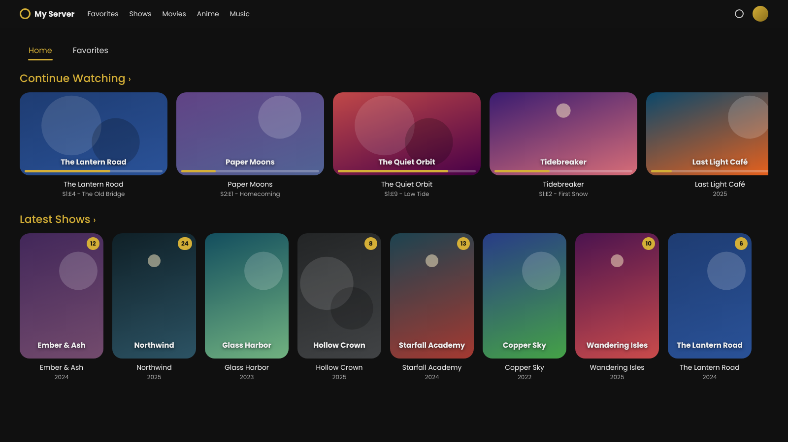

# Gilded

A rounded, dark and gold theme for [Jellyfin](https://jellyfin.org). Pure CSS, no plugins needed.



## Features

- Rounded posters, buttons, menus, dialogs and text fields
- Gold accents in place of Jellyfin's default blue: badges, progress bars, checkboxes, toggles, the video seek bar and the scrollbar
- Gold section headers and a gold underline on the active tab
- Frosted-glass top bar and pop-up menus
- Pill-shaped, gold **Play** button on show and movie pages
- Poppins font across the whole interface
- Cast and SyncPlay buttons hidden from the top bar
- Custom login page with your own banner image and server name
- Lightweight: no poster animations or heavy effects, so browsing stays fast

## Installation

1. In Jellyfin, open **Dashboard → General**.
2. Copy everything in [`gilded.css`](gilded.css) and paste it into **Custom CSS code**.
3. Click **Save**, then refresh the page with **Ctrl + F5**.

## Customizing

All the main settings are at the top of `gilded.css`:

```css
:root {
  --radius: 20px;    /* corner roundness: 6px subtle, 28px very round */
  --gold: #d4af37;   /* accent color */
  --outline: 3px;    /* thickness of gold borders */
}
```

Change `--gold` to any color to turn Gilded into a different theme. For example, `#c0c0c0` gives silver and `#e5a4b4` gives rose.

### Login page

Near the bottom of the file:

- **Banner image:** replace `YOUR-IMAGE-URL` with a direct link to your picture. The link must end in an image file such as `.png` or `.jpg`. To skip the banner, delete that block.
- **Server name:** change `"My Server"` to your server's name.
- **Bottom text:** the quote under the sign-in buttons is Jellyfin's *Login disclaimer*, set in **Dashboard → General**.

## Compatibility

- Tested on the Jellyfin **web client** and the desktop app.
- Works with both the classic layout and the newer experimental layout.
- Native apps that don't use the web client, such as Swiftfin, Roku and the native Android TV app, ignore custom CSS.

## Screenshots

| Home | Show page | Login |
|---|---|---|
|  |  |  |

## License

[MIT](LICENSE)
