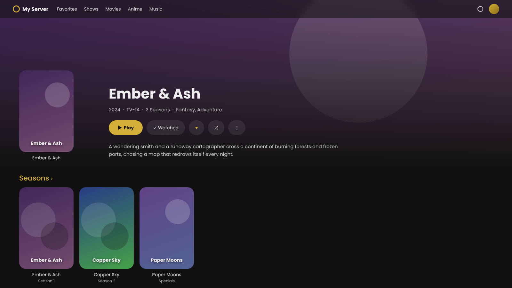
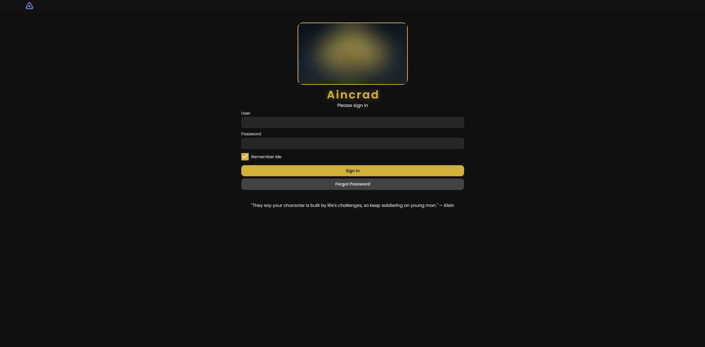

# Gilded

A rounded, dark and gold theme for [Jellyfin](https://jellyfin.org). Pure CSS, no plugins needed.


## Features

- Rounded posters, buttons, menus, dialogs and text fields
- Gold accents in place of Jellyfin's default blue: badges, progress bars, checkboxes, toggles, the video seek bar and the scrollbar
- Gold section headers and a gold underline on the active tab
- Frosted-glass top bar and pop-up menus
- Pill-shaped, gold **Play** button on show and movie pages
- Poppins font across the whole interface
- Cast and SyncPlay buttons hidden from the top bar
- Custom login page with your own banner image and server name
- Lightweight: no poster animations or heavy effects, so browsing stays fast

## Installation

1. In Jellyfin, open **Dashboard → General**.
2. Paste this one line into **Custom CSS code**:

   ```css
   @import url('https://cdn.jsdelivr.net/gh/Ricotoby/Gilded@main/gilded.css');
   ```

3. Click **Save**, then refresh the page with **Ctrl + F5**.

You'll get theme updates automatically. They can take up to 12 hours to show up because of the CDN's cache.

Prefer not to load from a link? Copy everything in [`gilded.css`](gilded.css) into **Custom CSS code** instead.

## Customizing

Add your changes **below** the `@import` line. They override the theme's defaults.

```css
@import url('https://cdn.jsdelivr.net/gh/Ricotoby/Gilded@main/gilded.css');

:root {
  --radius: 20px;    /* corner roundness: 6px subtle, 28px very round */
  --gold: #d4af37;   /* accent color */
  --outline: 3px;    /* thickness of gold borders */
}
```

Change `--gold` to any color to turn Gilded into a different theme. For example, `#c0c0c0` gives silver and `#e5a4b4` gives rose.

### Login page

The login banner and title are off by default. To turn them on, add this below the `@import` line:

```css
:root {
  --login-banner: block;
  --login-image: url("https://example.com/your-banner.png");
  --server-name: "My Server";
}
```

- **Banner image:** a direct link to your picture, ending in an image file such as `.png` or `.jpg`.
- **Server name:** shown in large gold letters under the banner.
- **Bottom text:** the quote under the sign-in buttons is Jellyfin's *Login disclaimer*, set in **Dashboard → General**.

## Compatibility

- Tested on the Jellyfin **web client** and the desktop app.
- Works with both the classic layout and the newer experimental layout.
- Native apps that don't use the web client, such as Swiftfin, Roku and the native Android TV app, ignore custom CSS.

## Screenshots

*Show artwork is blurred in these screenshots.*

| Home | Show page | Login |
|---|---|---|
|  |  |  |

## License

[MIT](LICENSE)
